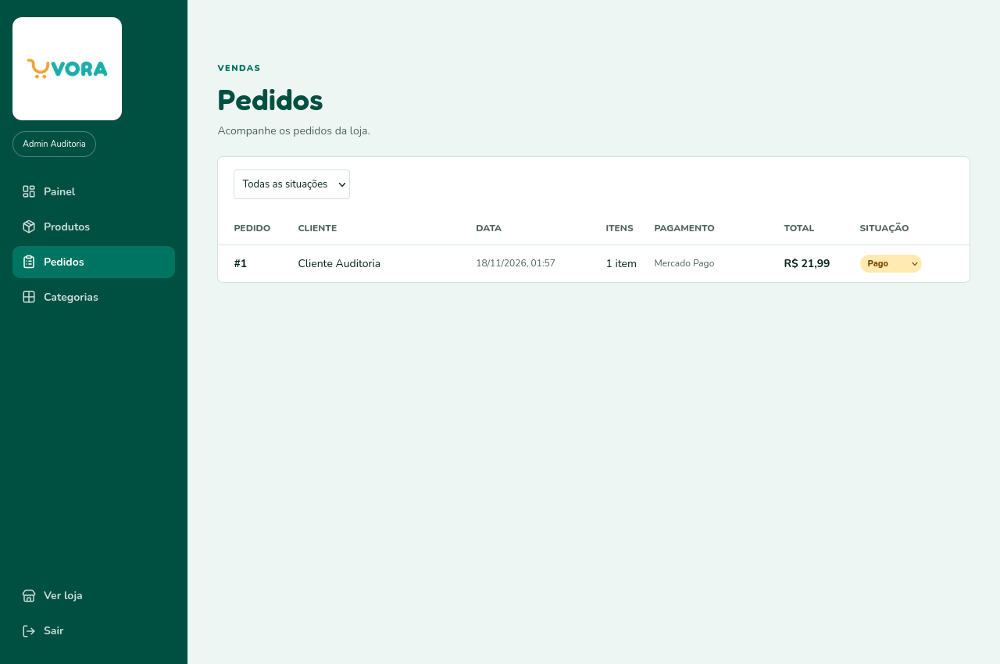

# Vora Supermarket

A Vora é uma loja virtual de supermercado criada para o Projeto Integrador de Desenvolvimento de Sistemas do SENAI. A versão publicada reúne catálogo, ofertas, favoritos, cálculo de frete por CEP, pedidos, checkout de teste e painel de administração.

[Abrir a loja na Vercel](https://loja-virtual-f96n.vercel.app/) · [Consultar a saúde da API no Render](https://vora-supermarket.onrender.com/health) · [Acompanhar a entrega no Trello](https://trello.com/b/Yt18MPIo/loja-virtual-kau%C3%AA-rom%C3%A3o)

**Tecnologias** · React, Vite, Tailwind CSS, Node.js, Express e SQLite/Turso

| Catálogo da loja | Painel de pedidos |
| --- | --- |
|  |  |

## Minha participação

Documentei a modelagem do banco de dados e apresentei o projeto integrador. A modelagem inclui um diagrama editável e um dicionário de dados. [Modelagem do banco](documentos/banco-de-dados.md) · [Histórico de implementação](https://github.com/KaahRomao/loja-virtual/commits/main/)

## Como usar

1. Explore o catálogo ou procure um produto. Nas fichas com mais de uma foto, use as miniaturas e o botão de ampliar. O coração no cabeçalho abre **Favoritos**.
2. Adicione produtos ao carrinho e informe um CEP válido. Para avançar no checkout, entre como cliente ou faça o cadastro. Ao entrar, a loja retoma a etapa e mantém o carrinho.
3. Confira os itens, o endereço, o frete e o prazo. Na confirmação, abra **Pagar com Mercado Pago** e, em seguida, **Abrir Mercado Pago** para usar a conta e o cartão de teste.
4. Acompanhe a compra em **Minha conta → Meus pedidos**. Use **Atualizar situação** no pedido para consultar o Mercado Pago.
5. Para administrar, use **Entrar** com uma conta administrativa. O menu **Painel da loja** abre o resumo, as fichas de produtos, as categorias e os pedidos.

Para ver os botões de edição, exclusão e restauração do catálogo, siga o [manual de uso](documentos/manual.md).

## Regras principais

| Tema | Regra aplicada |
| --- | --- |
| Entrega | A API consulta a UF do CEP no ViaCEP. São Paulo custa R$ 15,00 e leva até 3 dias úteis. RJ, MG e ES custam R$ 20,00 e levam até 5 dias úteis. Os demais estados custam R$ 30,00 e levam até 8 dias úteis. |
| Estoque | A API confere estoque e preços na criação do pedido e baixa as unidades na mesma transação. O painel sinaliza de 1 a 14 unidades como estoque baixo, zero como esgotado e sugere repor até 15. |
| Pedido | A API preserva o preço dos itens e o endereço da compra. Uma chave de checkout permite reenviar a mesma tentativa sem criar outro pedido. |
| Pagamento | O Checkout Pro usa credenciais de teste. O estado do pagamento é separado do estado do pedido. A API consulta o provedor e confere referência, valor e moeda antes de registrar a transação. |
| Cancelamento | O dono ou o administrador pode cancelar um pedido pendente elegível. A reposição de estoque ocorre uma vez. Se houver preferência criada, a API exige que ela tenha expirado e que o provedor confirme a ausência de pagamento aprovado ou em processamento. |
| Catálogo | O painel cadastra, edita, inativa e restaura fichas. Categorias ativas aparecem para visitantes, inclusive quando estão vazias. A exclusão inativa o registro e preserva o histórico. |
| Sessão e favoritos | Cliente e admin usam o mesmo login, com permissões verificadas na API. O carrinho fica no navegador. Os favoritos ficam separados por conta e pelo perfil de visitante no mesmo navegador. |

O pedido começa como **Pendente**. Uma aprovação o torna **Pago**. O administrador pode avançá-lo para **Enviado** e depois **Entregue**. O cancelamento leva um pedido pendente elegível para **Cancelado**. [Requisitos e casos de uso](documentos/requisitos.md)

## Arquitetura

```text
Navegador → React / Vite / Tailwind CSS / React Router
                      ↓ HTTP e JSON
             Node.js / Express / JWT / bcrypt
                  ↓                       ↓
       SQLite local ou Turso/libSQL     ViaCEP e Mercado Pago
```

| Diretório | Conteúdo |
| --- | --- |
| [front-end](front-end/) | Loja e painel em React, integração HTTP, rotas, armazenamento do navegador e imagens do catálogo. |
| [back-end](back-end/) | API Express com rotas, controllers, serviços, modelos, autenticação e inicialização do banco. |
| [documentos](documentos/) | Requisitos, manual, API, coleção Postman, modelagem e resultados das auditorias. |

O banco guarda clientes, administradores, produtos, categorias, pedidos e pagamentos. Os valores monetários ficam em centavos inteiros. A URL ou caminho da imagem principal fica em `produto.img_url`, e as fotos adicionais do catálogo ficam em `front-end/public/img/produtos/vora/`. [Modelagem e persistência](documentos/banco-de-dados.md)

## Rodar localmente

Use **Node.js 22.16.0 ou superior** e npm. Execute os comandos na raiz do repositório.

```bash
git clone https://github.com/KaahRomao/loja-virtual.git
cd loja-virtual
npm ci --prefix back-end
npm ci --prefix front-end
```

1. Ao configurar pela primeira vez, copie o modelo para `back-end/.env`. Gere um segredo local e cole o resultado no campo `JWT_SECRET`. Guarde o arquivo no ambiente local.

   ```bash
   if [ ! -e back-end/.env ]; then cp back-end/.env.example back-end/.env; fi
   node -e 'console.log(require("node:crypto").randomBytes(32).toString("hex"))'
   ```

   O padrão é `back-end/data/vora.sqlite`. Use `DB_PATH=./data/vora-teste.sqlite` para começar com um banco separado. O caminho relativo é calculado a partir de `back-end/`. [Variáveis de exemplo da API](back-end/.env.example)

2. No primeiro terminal, rode a API. O endereço padrão é `http://127.0.0.1:3000`.

   ```bash
   npm --prefix back-end run dev
   ```

3. No segundo terminal, rode o front-end e abra `http://localhost:5173`. O Vite encaminha `/api` à porta 3000 por padrão.

   ```bash
   npm --prefix front-end run dev
   ```

4. Confira a conexão. A primeira chamada verifica acesso ao banco. A segunda passa pelo proxy do front-end e consulta os produtos.

   ```bash
   curl http://127.0.0.1:3000/health
   curl http://localhost:5173/api/produtos
   ```

### Criar um administrador local

No Bash, execute o comando a partir da raiz. Use um e-mail ainda não cadastrado e defina uma senha de pelo menos seis caracteres. O script lê a mesma configuração de banco da API. Depois, use a tela **Entrar** da loja.

```bash
read -rsp 'Senha do administrador: ' VORA_ADMIN_PASSWORD
printf '\n'
VORA_ADMIN_PASSWORD="$VORA_ADMIN_PASSWORD" node back-end/scripts/criar-admin.js "Admin Vora" "admin@vora.test"
unset VORA_ADMIN_PASSWORD
```

### Testar o Mercado Pago

1. Configure `MP_TEST_ACCESS_TOKEN` no ambiente da API com o Access Token de teste do vendedor e reinicie o servidor. Use o comprador e um cartão de teste do Mercado Pago. [Compras de teste no Checkout Pro](https://www.mercadopago.com.br/developers/pt/docs/checkout-pro-preferences/integration-test/test-purchases)
2. Monte um carrinho e use, por exemplo, o CEP `01001-000`. Entre como cliente, confirme o endereço e crie o pedido.
3. Na página do pedido, clique em **Pagar com Mercado Pago** e **Abrir Mercado Pago**. Conclua o teste no provedor e consulte o pedido. A atualização também pode ser acionada pelo botão **Atualizar situação**.
4. Use uma origem HTTPS pública em `MP_RETURN_URL` para retornar automaticamente ao site. Para usar notificações assinadas, configure a rota pública `/pagamentos/webhook` em `MP_WEBHOOK_URL` e a chave da aplicação em `MP_WEBHOOK_SECRET`. O segredo e o Access Token ficam no servidor. [Configuração do retorno](https://www.mercadopago.com.br/developers/pt/docs/checkout-pro-preferences/configure-back-urls) · [Configuração de notificações](https://www.mercadopago.com.br/developers/pt/docs/checkout-pro-preferences/payment-notifications)

## Publicação

| Serviço | Configuração usada pelo projeto |
| --- | --- |
| Vercel | Branch `main`, raiz `front-end`, build Vite e saída `dist`. `VITE_API_URL` aponta para a API HTTPS do Render. `vercel.json` encaminha as rotas da SPA ao `index.html`. |
| Render | Branch `vercel`, raiz `back-end`, build `npm ci`, início `npm start` e verificação em `/health`. A API escuta em `0.0.0.0` na porta do serviço. |
| Turso | Com `RENDER=true`, `TURSO_DATABASE_URL` e `TURSO_AUTH_TOKEN` conectam a API ao banco remoto. Os registros permanecem no Turso entre publicações do Render. |

Defina `JWT_SECRET` e a origem HTTPS do site em `FRONT_URL` no Render. Configure as variáveis `MP_*` conforme o fluxo de teste. Em localhost, o arquivo SQLite é criado e mantido pela API.

Em 20/11/2026, a API pública respondeu 200 em `/health`. A confirmação automática por webhook ainda depende do segredo de assinatura no Render. O checkout de teste pode ser conferido pela consulta ao provedor em **Atualizar situação**.

[Configuração do front-end](front-end/.env.example) · [Web Services no Render](https://render.com/docs/web-services) · [Variáveis na Vercel](https://vercel.com/docs/environment-variables)

## Testes

```bash
npm --prefix back-end test
VORA_TEST_LIBSQL=1 npm --prefix back-end test
npm --prefix front-end run lint
npm --prefix front-end run build
```

A suíte usa um banco isolado para verificar o fluxo HTTP e simula as respostas do ViaCEP e do Mercado Pago. A opção `VORA_TEST_LIBSQL=1` verifica o adaptador libSQL em arquivo. Use a coleção Postman na API local para repetir os cenários. O pagamento de teste no provedor e a entrega de webhook na nuvem têm validação própria.

[Contrato da API](documentos/API.md) · [Coleção Postman](documentos/Vora.postman_collection.json) · [Resultados de testes](documentos/testes.csv)

[Captura da confirmação de um pedido com pagamento simulado](documentos/capturas/pedido-360.png)

## Documentação e materiais

| Material | Onde abrir |
| --- | --- |
| Briefing e catálogo | [Público, proposta e referências](documentos/briefing.md) · [Catálogo inicial com 16 produtos](documentos/catalogo-inicial.csv) |
| Manual e requisitos | [Manual da loja](documentos/manual.md) · [Requisitos e casos de uso](documentos/requisitos.md) |
| Modelagem de dados | [Guia do banco](documentos/banco-de-dados.md) · [Draw.io editável](documentos/loja_virtual.drawio) · [Dicionário XLSX](documentos/lojaVirtual_dicionario.xlsx) |
| Auditorias | [Cliente e administração](documentos/auditoria-vora.md) · [Jornada extensa](documentos/auditoria-jornada-extensa.md) · [Apresentação](documentos/auditoria-professor-vora.md) |
| Marca e mídias | [Identidade visual em PDF](documentos/identidade-visual-vora.pdf) · [Logo em PNG](front-end/src/assets/vora-logo.png) · [Logo em SVG](documentos/marca/vora-logo.svg) · [Versão reduzida em SVG](documentos/marca/vora-simbolo.svg) · [Figma com perfil, post, capa e roteiro de Reel](https://www.figma.com/design/II23DswXQi3jbtvJJz2k6o/Vora-Supermarket-%E2%80%94-Instagram--post-e-Reel?node-id=0-1&p=f) |
| Protótipo e planejamento | [Protótipo no Lovable](https://vora-supermarket-front.lovable.app/) · [Trello do projeto](https://trello.com/b/Yt18MPIo/loja-virtual-kau%C3%AA-rom%C3%A3o) · [Próximas melhorias em PDF](https://loja-virtual-f96n.vercel.app/proximas-melhorias.pdf) |

Para editar a modelagem, baixe o arquivo `.drawio` e abra no diagrams.net. A planilha descreve campos, chaves, padrões e validações do banco. O Trello usa a visibilidade do workspace e pode exigir acesso à equipe.
