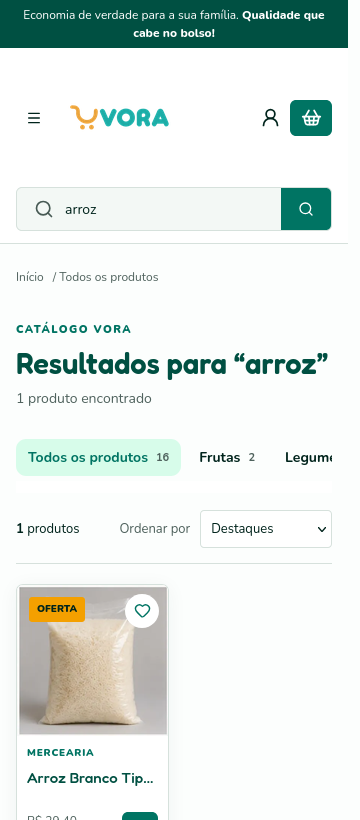
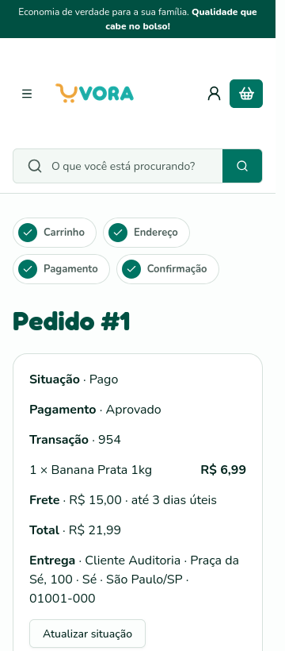

# Vora Supermarket

Loja virtual do Projeto Integrador de Desenvolvimento de Sistemas do SENAI. A Vora oferece um catálogo de supermercado, cálculo de entrega por CEP, checkout de teste e um painel para administrar produtos, categorias e pedidos.

React, Vite e Tailwind no front-end. Node.js, Express, JWT, bcrypt e SQLite no back-end. O ViaCEP fornece o endereço e o Mercado Pago Checkout Pro é usado para compras de teste.

## Rodar localmente

Use **Node.js 22.16 ou superior** e npm. A API usa a porta **3000** e o front-end usa a **5173**. O Vite encaminha `/api` para a API local.

1. Instale as dependências a partir da raiz do repositório.

   ```bash
   npm ci --prefix back-end
   npm ci --prefix front-end
   ```

2. Se ainda não existir, crie `back-end/.env` usando `back-end/.env.example`. Preencha `JWT_SECRET` com um segredo gerado localmente. Este comando imprime um valor para copiar para o arquivo.

   ```bash
   node -e 'console.log(require("node:crypto").randomBytes(32).toString("hex"))'
   ```

   Sem `DB_PATH`, a API cria `back-end/data/vora.sqlite` na primeira execução. Se já houver um banco local, use `DB_PATH=./data/vora-entrega.sqlite` em `.env` para começar a demonstração com uma base separada. O caminho relativo é calculado a partir de `back-end/`. Um arquivo existente mantém seus registros.

3. Em um terminal, inicie a API.

   ```bash
   npm --prefix back-end run dev
   ```

4. Em outro terminal, inicie o front-end e abra **http://localhost:5173**.

   ```bash
   npm --prefix front-end run dev
   ```

5. Para entrar em **http://localhost:5173/admin**, crie um administrador no mesmo SQLite usado pela API. No Bash, leia a senha sem exibi-la ou incluí-la no histórico.

   ```bash
   read -rsp 'Senha do administrador (mínimo de 6 caracteres): ' VORA_ADMIN_PASSWORD
   printf '\n'
   VORA_ADMIN_PASSWORD="$VORA_ADMIN_PASSWORD" node back-end/scripts/criar-admin.js "Admin Vora" "admin@vora.test"
   unset VORA_ADMIN_PASSWORD
   ```

## Compra de teste no Mercado Pago

1. Na aplicação do Checkout Pro, use as **credenciais de teste do vendedor** e configure o Access Token em `MP_TEST_ACCESS_TOKEN` no `back-end/.env`. Reinicie a API. Use a conta de comprador e o cartão de teste fornecidos pelo Mercado Pago. [Contas de teste](https://www.mercadopago.com.br/developers/pt/docs/checkout-pro-preferences/test-accounts) · [Compras de teste](https://www.mercadopago.com.br/developers/pt/docs/checkout-pro-preferences/integration-test/test-purchases)
2. No catálogo, adicione um item e prossiga ao endereço. Use, por exemplo, o CEP `01001-000`. Informe o número, entre na conta da loja e confirme o pedido.
3. Na página do pedido, selecione **Preparar pagamento de teste** e **Abrir Checkout Pro**. No roteiro local, conclua o teste na aba do Mercado Pago. Volte à aba da loja e use **Atualizar situação**. A API consulta a referência do pedido diretamente no provedor.
4. Para retorno por redirecionamento e webhook, configure `MP_RETURN_URL` com a origem HTTPS pública do front-end. Configure também `MP_WEBHOOK_URL` com a rota pública `/pagamentos/webhook` da API, ou `/api/pagamentos/webhook` quando houver proxy. Use `MP_WEBHOOK_SECRET` com a assinatura da aplicação. As URLs de retorno do Mercado Pago exigem um domínio acessível. [URLs de retorno](https://www.mercadopago.com.br/developers/pt/docs/checkout-pro-preferences/configure-back-urls) · [Notificações](https://www.mercadopago.com.br/developers/pt/docs/checkout-pro-preferences/payment-notifications)

O Access Token fica no servidor. O checkout usa a credencial de teste configurada para a entrega.

## Publicação na Vercel e no Render

- **Render.** Use o Web Service existente, com `back-end` como diretório raiz, `npm ci` no build, `npm start` na inicialização e Node.js 22.16 ou superior. A API usa o `PORT` do Render e escuta em `0.0.0.0`. Configure `/health` para verificar a leitura do SQLite e `FRONT_URL` com a origem HTTPS da loja. Configure `JWT_SECRET` no painel do serviço. [Web Services](https://render.com/docs/web-services) · [Health checks](https://render.com/docs/health-checks)
- **Banco no Render gratuito.** Configure `TURSO_DATABASE_URL` e `TURSO_AUTH_TOKEN` no painel do serviço. Quando inicia no Render com essas variáveis, a API usa o Turso da loja e completa o esquema sem recarregar o catálogo de um banco existente. Em localhost, o projeto continua usando o SQLite em arquivo. [Cliente libSQL para Turso](https://docs.turso.tech/sdk/ts/reference)
- **Checkout público de teste.** Configure `MP_TEST_ACCESS_TOKEN` no painel do Render com o Access Token do ambiente de teste da aplicação. Para voltar automaticamente à loja, use a origem HTTPS da Vercel em `MP_RETURN_URL`.
- **Vercel.** Use o projeto existente com `front-end` como diretório raiz. No ambiente de produção, defina `VITE_API_URL` com a URL HTTPS da API do Render e publique o build. Confira `/health`, `/produtos` e a listagem na loja pública. [Monorepos](https://vercel.com/docs/monorepos) · [Variáveis da Vercel](https://vercel.com/docs/environment-variables)

## Auditoria

```bash
npm --prefix back-end test
npm --prefix front-end run lint
npm --prefix front-end run build
```

O teste da API abre um servidor em loopback e cria um SQLite temporário. As respostas do ViaCEP e do Mercado Pago são controladas para reproduzir sucessos e falhas. Os resultados do navegador usam o mesmo tipo de simulação para as integrações externas.

| Catálogo em 360 px | Pedido em 360 px |
| --- | --- |
|  |  |

[Captura do painel administrativo](documentos/capturas/painel-pedidos.png)

- [API e exemplos](documentos/API.md)
- [Manual e roteiro de demonstração](documentos/manual.md)
- [Resultados de testes](documentos/testes.csv)
- [Requisitos e casos de uso](documentos/requisitos.md)
- [DER no Draw.io](documentos/loja_virtual.drawio) e [dicionário de dados](documentos/lojaVirtual_dicionario.xlsx)
- [Criação do SQLite](back-end/src/database/sql/create.sql) e [dados do catálogo](back-end/src/database/sql/insert.sql)

O esquema mantém os nomes `produto_pedido` para os itens e `administrador` para os usuários do painel. Valores monetários ficam em centavos inteiros e as novas datas são gravadas em UTC. Pedidos têm uma cópia textual do endereço. Cada tentativa de pagamento guarda a situação e o identificador externo.
