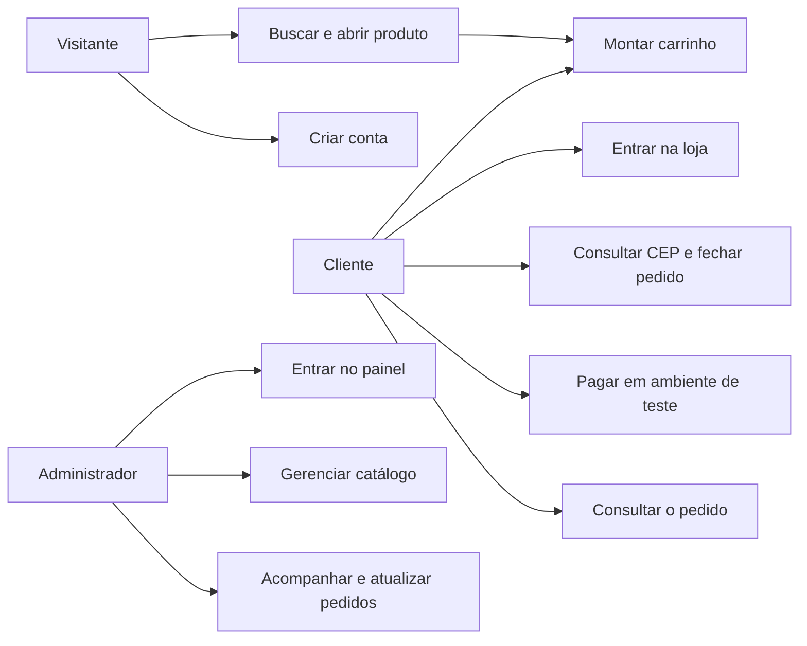

# Requisitos da implementação

A Vora é um supermercado virtual voltado a famílias que buscam praticidade e economia. O catálogo local de demonstração tem 16 produtos distribuídos entre Hortifruti, Mercearia, Bebidas, Laticínios e Frios e Padaria, com duas subcategorias de Hortifruti.

| Código | Prioridade | Ação verificável |
| --- | --- | --- |
| RF01 | Essencial | Visitante consulta o catálogo, busca pelo nome, filtra por categoria e abre os detalhes. |
| RF02 | Essencial | Visitante cria uma conta e cliente entra com e-mail e senha. |
| RF03 | Essencial | Cliente adiciona, remove ou ajusta quantidades no carrinho. |
| RF04 | Essencial | Loja completa os dados do endereço pelo CEP e calcula frete e prazo antes de fechar o pedido. |
| RF05 | Essencial | Cliente autenticado registra o pedido e consulta seus itens e situação. |
| RF06 | Essencial | Cliente inicia o Checkout Pro de teste. A API consulta a transação e registra status e identificador. |
| RF07 | Essencial | Administrador autorizado mantém produtos e categorias e acompanha pedidos. |
| RF08 | Importante | Administrador avança um pedido pago para envio e entrega ou cancela um pedido pendente. |
| RNF01 | Essencial | Senhas são protegidas com bcrypt. O JWT expira em duas horas. As credenciais são locais ao servidor. |
| RNF02 | Essencial | O projeto roda com SQLite, Express e React na mesma máquina. Preços em centavos são mantidos sem arredondamento de ponto flutuante no banco. |
| RNF03 | Essencial | O checkout e a consulta do pedido são utilizáveis em largura de 360 px. |
| RNF04 | Importante | Um SQLite em volume persistente pode ser copiado e restaurado. Faça a cópia com a API parada ou use a função de backup do SQLite. |

## Atores e casos de uso

A regra de entrega é R$ 15 e até 3 dias úteis para São Paulo, R$ 20 e até 5 dias úteis para RJ, MG e ES, e R$ 30 e até 8 dias úteis para os demais estados. O SQLite guarda pedidos e tentativas de pagamento. O carrinho da interface é compartilhado entre as páginas e preservado na sessão da aba.

## Complemento do dicionário de dados

O esquema físico atual está em [create.sql](../back-end/src/database/sql/create.sql). Os campos abaixo complementam a planilha existente.

| Tabela | Campo | Tipo no SQLite | Uso |
| --- | --- | --- | --- |
| cliente | telefone | TEXT opcional, até 24 caracteres na API | Contato informado no cadastro |
| produto | unidade | TEXT, padrão vazio | Embalagem ou unidade exibida na loja |
| produto | preco_anterior | INTEGER opcional | Preço anterior em centavos, maior que o preço atual |
| pedido | chave_checkout | TEXT opcional, 36 caracteres | Identifica uma tentativa de envio e é única por cliente |
| pedido | referencia_pagamento | TEXT opcional, 41 caracteres | Identifica o pedido no provedor, sem reutilizar IDs de bancos diferentes |
| pedido | preferencia_id | TEXT opcional | Identificador da preferência devolvida pelo Checkout Pro |
| pedido | preferencia_url | TEXT opcional | Link do Checkout Pro associado à preferência |
