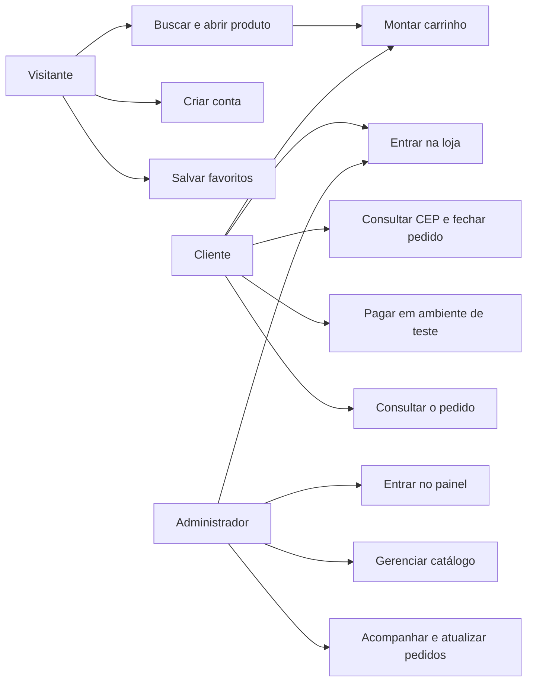

# Requisitos da implementação

A Vora é um supermercado virtual voltado a famílias que buscam praticidade e economia. O catálogo local de demonstração tem 16 produtos distribuídos entre Hortifruti, Mercearia, Bebidas, Laticínios e Frios e Padaria, com duas subcategorias de Hortifruti.

| Código | Prioridade | Ação verificável |
| --- | --- | --- |
| RF01 | Essencial | Visitante consulta o catálogo, busca pelo nome, filtra por categoria e abre os detalhes. |
| RF02 | Essencial | Visitante cria uma conta e cliente entra com e-mail e senha. |
| RF03 | Essencial | Visitante ou cliente adiciona, remove ou ajusta quantidades no carrinho. A confirmação exige login como cliente. |
| RF04 | Essencial | Loja completa os dados do endereço pelo CEP e calcula frete e prazo antes de fechar o pedido. |
| RF05 | Essencial | Cliente autenticado registra o pedido e consulta seus itens e situação. |
| RF06 | Essencial | Cliente inicia o Checkout Pro de teste. A API consulta a transação e registra status e identificador. |
| RF07 | Essencial | Administrador autorizado cadastra, edita, inativa e restaura produtos e categorias e acompanha os pedidos. |
| RF08 | Importante | Administrador avança um pedido pago para envio e entrega. O dono ou o administrador pode cancelar um pedido pendente elegível. |
| RF09 | Importante | Visitante ou conta autenticada consulta e altera sua lista de favoritos no navegador. |
| RF10 | Importante | Visitante vê ofertas, fotos adicionais nas fichas com galeria e disponibilidade no catálogo. |
| RNF01 | Essencial | Senhas são protegidas com bcrypt. O JWT expira em duas horas. As credenciais são locais ao servidor. |
| RNF02 | Essencial | O projeto roda com SQLite, Express e React na mesma máquina. Preços em centavos são mantidos sem arredondamento de ponto flutuante no banco. |
| RNF03 | Essencial | O checkout e a consulta do pedido são utilizáveis em largura de 360 px. |
| RNF04 | Importante | A loja publicada persiste os dados no Turso. Para copiar o arquivo SQLite local, faça a cópia com a API parada ou use o mecanismo de backup do SQLite. |
| RNF05 | Essencial | A API aplica as permissões dos papéis e limita o histórico do cliente aos próprios pedidos. |

## Atores e casos de uso

| Ator | História de usuário | Requisitos |
| --- | --- | --- |
| Visitante | Quero filtrar as categorias e comparar ofertas para encontrar os produtos da minha lista. | RF01, RF10 |
| Cliente | Quero saber o frete, pagar em teste e acompanhar o pedido na minha conta. | RF04, RF05, RF06 |
| Administrador | Quero identificar itens para reposição e atualizar a situação dos pedidos. | RF07, RF08 |

## Regras de negócio

- A área atendida segue as faixas de UF para CEPs válidos encontrados pelo ViaCEP. Para SP, o frete é de R$ 15,00 e o prazo é de até 3 dias úteis. Para RJ, MG e ES, são R$ 20,00 e até 5 dias úteis. Para os demais estados, são R$ 30,00 e até 8 dias úteis.
- Uma categoria ativa aparece na vitrine mesmo vazia. Para inativá-la, mova ou inative os produtos e subcategorias ativos. Para restaurar uma subcategoria, a categoria-pai deve estar ativa.
- Estoque zero significa esgotado. O painel indica estoque baixo de 1 a 14 unidades e sugere repor até 15. A exclusão de produto é lógica e preserva fichas do histórico.
- O pedido mantém o preço unitário da compra, a quantidade, o frete e a cópia do endereço. O checkout usa uma chave por tentativa para prevenir a duplicação em reenvios. Uma aprovação conciliada pode levar o pedido a Pago.
- O cancelamento exige pedido pendente elegível. Se existe uma preferência do Mercado Pago, a API verifica expiração e ausência de pagamento aprovado ou em processo antes de devolver o estoque.

O checkout de teste, a persistência em nuvem e o acesso por papéis fazem parte da entrega. O catálogo de teste, os compradores de teste e as respostas simuladas da suíte são usados na validação. As melhorias futuras incluem ampliar opções de entrega, evoluir a administração e sincronizar favoritos entre dispositivos.

[Guia do banco](banco-de-dados.md) · [Cobertura de testes](testes.csv) · [Próximas melhorias](https://loja-virtual-f96n.vercel.app/proximas-melhorias.pdf)
