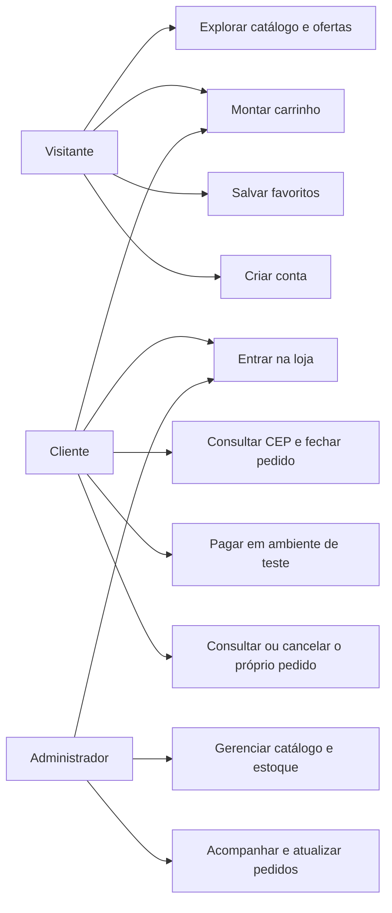

# Vora Supermarket · Especificação de Requisitos (URS e SRS)

**Projeto Integrador de Desenvolvimento de Sistemas · SENAI** · Revisão de 20/11/2026

A Vora é uma loja virtual para famílias que buscam praticidade e economia. O visitante pode explorar o catálogo, montar o carrinho e calcular o frete. O cliente pode fechar um pedido, pagar em ambiente de teste e acompanhar a compra. O administrador gerencia o catálogo, o estoque e a situação dos pedidos.

A especificação de requisitos do usuário (URS) registra o que cada perfil precisa fazer. A especificação de requisitos de software (SRS) descreve como a Vora deve responder. Cada linha reúne a necessidade, a regra do sistema e o resultado que comprova o requisito.

O catálogo inicial do SQLite tem 16 produtos. São cinco categorias principais e duas subcategorias de Hortifruti. [Loja publicada](https://loja-virtual-f96n.vercel.app/) · [Briefing do projeto](briefing.md) · [Catálogo inicial](catalogo-inicial.csv)

## Perfis e acesso

| Perfil | Acesso |
| --- | --- |
| Visitante | Navega pelo catálogo, consulta ofertas e CEP, usa o carrinho e salva favoritos no navegador. Pode se cadastrar ou entrar. |
| Cliente | Usa a loja, conclui o checkout, consulta os próprios pedidos e cancela um pedido elegível. |
| Administrador | Entra pelo mesmo formulário da loja. O papel da conta dá acesso ao painel de produtos, categorias, estoque e pedidos. |

## Requisitos funcionais

| Código e prioridade | Necessidade do usuário (URS) | Comportamento do software (SRS) | Critério de aceite |
| --- | --- | --- | --- |
| **RF01 · Essencial** | Como visitante, quero buscar e filtrar produtos para encontrar o que preciso. | A loja mostra os produtos ativos de categorias ativas. Permite buscar por nome, filtrar por categoria e abrir a ficha. Categoria ativa sem produtos mostra um estado vazio. Uma categoria inexistente exibe a página 404 da Vora. | Buscar um produto existente, encontrá-lo pelo filtro e abrir a ficha. Abrir uma categoria ativa vazia e depois um endereço de categoria inexistente. |
| **RF02 · Essencial** | Como cliente, quero criar uma conta e entrar para comprar. Como administrador, quero usar a mesma tela de login. | O cadastro recebe nome, e-mail, senha e telefone opcional. O formulário de entrada aceita os dois perfis, e a API retorna o papel da conta autenticada. | Cadastrar um cliente, tentar repetir o e-mail e conferir a mensagem. Entrar como cliente e como administrador e conferir o menu de cada perfil. |
| **RF03 · Essencial** | Como visitante, quero montar meu carrinho antes de fazer login e continuar a compra com os itens escolhidos. | A loja permite adicionar e remover itens e ajustar quantidades dentro do estoque disponível. O carrinho fica no navegador. A próxima etapa do checkout exige login como cliente. A loja retoma a rota solicitada após a autenticação. | Adicionar duas unidades como visitante. Avançar para o endereço, entrar como cliente e conferir a rota, os itens e suas quantidades. |
| **RF04 · Essencial** | Como cliente, quero saber quanto custa e quando chega antes de fechar o pedido. | A API consulta o CEP no ViaCEP, calcula o frete pela UF e informa o prazo. A tela preenche os dados disponíveis, permite informar o número e o complemento e exibe o frete no resumo. | Consultar `01001-000` e obter R$ 15,00 e até 3 dias úteis. Informar um CEP inválido ou inexistente e conferir a mensagem e o bloqueio da confirmação. |
| **RF05 · Essencial** | Como cliente, quero confirmar o pedido uma vez e encontrá-lo em **Meus pedidos**. | A API recalcula os valores no servidor e confere o estoque. Grava pedido, itens e baixa de estoque em uma transação. O detalhe do pedido mostra situação, quantidades, valores e frete. Um reenvio com a mesma chave e os mesmos dados devolve o mesmo pedido. | Confirmar a compra, abrir o pedido pelo histórico e conferir itens e totais. Reenviar a mesma tentativa em uma base de teste e confirmar apenas um pedido e uma baixa de estoque. |
| **RF06 · Essencial** | Como cliente, quero pagar em ambiente de teste e ver se o pagamento foi aprovado. | A API cria o link do Checkout Pro para um pedido pendente. Na sincronização, confere referência, valor e moeda com o Mercado Pago e registra a transação por identificador externo. Uma aprovação conciliada leva o pedido pendente a **Pago**. | Em um teste controlado, abrir o checkout, concluir um pagamento de teste e selecionar **Atualizar situação**. Repetir a consulta e conferir o mesmo registro de pagamento. |
| **RF07 · Essencial** | Como administrador, quero manter produtos e categorias, identificar itens para reposição e acompanhar os pedidos. | O painel permite cadastrar, editar, inativar e restaurar produtos e categorias. A ficha do produto permite alterar preço, promoção e estoque. O painel lista pedidos e sinaliza itens para reposição. | Criar uma categoria em uma base de teste e abrir a vitrine em outra sessão. Editar um produto, ajustar o saldo para 12 e conferir a indicação de repor 3 unidades. Inativar e restaurar o produto pelo painel. |
| **RF08 · Importante** | Como cliente, quero cancelar um pedido elegível. Como administrador, quero registrar o envio e a entrega. | O cliente pode cancelar o próprio pedido pendente elegível, e o administrador tem a mesma operação no painel. O cancelamento devolve o estoque. Um pedido pago pode avançar para enviado e depois entregue. | Cancelar um pedido pendente elegível e conferir a reposição uma vez. Tentar cancelar com link ativo e conferir o bloqueio. Em outro pedido pago, registrar envio e entrega nessa ordem. |
| **RF09 · Importante** | Como visitante ou usuário da loja, quero salvar produtos e abrir meus favoritos depois. | O coração de cada ficha altera a lista acessível no cabeçalho. A loja mantém listas separadas por papel e conta no mesmo navegador, além da lista de visitante. | Favoritar um produto, recarregar a página e abrir **Favoritos**. Entrar em outra conta no mesmo navegador e conferir que ela tem uma lista própria. |
| **RF10 · Importante** | Como visitante, quero comparar preços, conferir ofertas e ver os detalhes dos produtos. | A loja exibe banners e uma seção de ofertas quando há promoções disponíveis. A ficha de oferta mostra preço atual e anterior. O detalhe indica disponibilidade, oferece ampliação quando há foto e exibe miniaturas quando há mais de uma. | Abrir uma oferta e conferir os dois preços e a identificação do desconto. Abrir uma ficha com duas fotos, alternar a imagem e testá-la ampliada. |

## Atores e casos de uso

## Regras de negócio

### Frete e prazo (RF04)

As faixas se aplicam quando o ViaCEP encontra o CEP e informa a UF.

| UF | Frete | Prazo estimado |
| --- | ---: | --- |
| SP | R$ 15,00 | Até 3 dias úteis |
| RJ, MG e ES | R$ 20,00 | Até 5 dias úteis |
| Demais UFs | R$ 30,00 | Até 8 dias úteis |

### Catálogo e estoque (RF01, RF07 e RF10)

- O preço anterior de uma oferta precisa ser maior que o preço atual. O destaque de estoque baixo se aplica de 1 a 14 unidades. Estoque zero significa esgotado. O painel sugere repor até 15 unidades.
- Uma categoria ativa aparece na vitrine mesmo vazia. Para inativá-la, mova ou inative os produtos e subcategorias ativos. Para restaurar uma subcategoria, a categoria-pai deve estar ativa.
- **Excluir produto** inativa a ficha e os registros equivalentes. O histórico de compras permanece disponível.

### Pedido e pagamento (RF05, RF06 e RF08)

Um pedido nasce **Pendente** e guarda uma cópia do endereço, do preço unitário de cada item, do frete e do total. A baixa do estoque ocorre na criação do pedido. Reenviar a mesma chave de checkout com conteúdo diferente retorna HTTP 409.

| Situação do pedido | Condição | Próxima situação |
| --- | --- | --- |
| Pendente | A API confirma um pagamento aprovado com valor e moeda compatíveis. | Pago |
| Pendente | O dono ou o administrador confirma um cancelamento elegível. | Cancelado |
| Pago | O administrador registra o envio. | Enviado |
| Enviado | O administrador registra a entrega. | Entregue |

Quando já existe um link de pagamento, a API precisa confirmar que o link expirou e que o provedor informa ausência de pagamento aprovado ou em processamento antes de cancelar. Um cancelamento elegível repõe o estoque uma vez. O pagamento tem situação própria (**Pendente**, **Aprovado** ou **Recusado**). Uma recusa mantém o pedido pendente. Uma aprovação recebida após cancelamento gera um alerta no painel e preserva o estado do pedido.

## Requisitos não funcionais

| Código e prioridade | Necessidade do usuário (URS) | Comportamento do software (SRS) | Critério de aceite |
| --- | --- | --- | --- |
| **RNF01 · Essencial** | Quero entrar com segurança e sair da conta ao terminar. | As senhas são armazenadas com hash bcrypt. O JWT expira em duas horas. A sessão permanece na aba por meio de `sessionStorage`, e as credenciais de integração ficam no servidor. | Entrar, sair e tentar abrir uma rota protegida. Conferir que a API exige um JWT válido, que o token expira em 7.200 segundos e que as respostas públicas omitem senhas. |
| **RNF02 · Essencial** | Quero que o total mostrado corresponda ao preço dos itens e ao frete. | A aplicação roda localmente com React, Express e SQLite. A API calcula e o banco persiste os montantes como inteiros em centavos. | Em uma base local, comprar duas unidades de R$ 5,99 com frete de R$ 15,00. Conferir R$ 26,98 na interface e `2698` na API e no banco. |
| **RNF03 · Essencial** | Quero conseguir comprar e acompanhar o pedido pelo celular. | O carrinho, as etapas do checkout e o detalhe do pedido devem ser utilizáveis a partir de 360 px de largura. | Em 360 px, percorrer as etapas e abrir o pedido. Os campos, os botões e os valores devem caber na tela sem rolagem horizontal da página. |
| **RNF04 · Importante** | Quero encontrar os produtos, cadastros e pedidos depois de reiniciar a aplicação. | A API local persiste no SQLite em arquivo. A API publicada no Render persiste no Turso. Para cópias locais, usar o mecanismo de backup do SQLite ou copiar o arquivo com a API parada. | Criar um pedido em uma base isolada, reiniciar a API apontando para a mesma base e consultar o pedido novamente. |
| **RNF05 · Essencial** | Como cliente, quero que apenas eu e os administradores autorizados acessem meu pedido. | A API confere o papel do JWT e restringe as rotas de cliente ao dono do pedido. A interface exige login e papel administrativo para as telas do painel. | Com token de cliente, consultar uma rota administrativa e receber HTTP 401. Com outro cliente, consultar o pedido e receber HTTP 404. Com a própria conta, abrir o pedido. |
| **RNF06 · Importante** | Quero entender o que aconteceu se o CEP, o pagamento ou o servidor falhar. | A API informa erros de validação, conflito ou falha de integração. Erros internos retornam uma mensagem genérica. `GET /health` informa se o banco está acessível. | Simular indisponibilidade do ViaCEP e conferir HTTP 502 com mensagem no fluxo de CEP. Consultar `/health` com o banco acessível e obter HTTP 200. |

## Interfaces e persistência

| Componente | Interface ou armazenamento | Requisitos relacionados |
| --- | --- | --- |
| Loja React na Vercel e API Express no Render | A loja consulta a API por HTTPS e JSON. Catálogo, conta, checkout e administração têm rotas próprias. As rotas protegidas recebem `Authorization: Bearer <token>`. | RF01–RF10, RNF01, RNF03, RNF05 |
| ViaCEP | A API consulta o ViaCEP e entrega endereço, frete e prazo à loja em `GET /cep/:cep`. A UF é consultada novamente ao registrar uma compra nova. | RF04, RF05, RNF06 |
| Mercado Pago Checkout Pro | `POST /pedidos/:id/pagamento` cria ou recupera o link. `POST /pagamentos/sincronizar` atualiza a transação pela consulta ao provedor. A tela do Checkout Pro recebe os dados do cartão. | RF06, RF08, RNF06 |
| SQLite e Turso | Guardam contas, catálogo, pedidos e pagamentos. O endereço da compra fica no pedido. A mídia principal do produto é referenciada por URL ou caminho. | RF02, RF05–RF08, RF10, RNF02, RNF04 |
| Navegador | Mantém o carrinho e os favoritos em `localStorage`, com alternativa em `sessionStorage` quando necessário. As fotos adicionais do catálogo ficam no front-end. | RF03, RF09, RF10 |

[Contrato da API](API.md) · [Guia do banco](banco-de-dados.md) · [Instruções de instalação e publicação](../README.md)

## Validação e próximos passos

O catálogo, as contas, o painel administrativo e a persistência de pedidos fazem parte da entrega. O checkout usa o ambiente de teste do Mercado Pago. A suíte automatizada usa um banco isolado e simula as respostas do ViaCEP e do Mercado Pago. [Manual de demonstração](manual.md) · [Resultados dos testes](testes.csv) · [Coleção Postman](Vora.postman_collection.json)

A confirmação automática por webhook tem tratamento de assinatura na API. Na verificação pública de 20/11/2026, faltava configurar o segredo de assinatura no Render. O fluxo de teste pode ser conferido pela consulta ao provedor em **Atualizar situação**. [Registro da auditoria](auditoria-professor-vora.md)

O planejamento futuro inclui regras comerciais de regiões de entrega e trocas, gestão de estoque por produto e favoritos sincronizados entre dispositivos. [Próximas melhorias](https://loja-virtual-f96n.vercel.app/proximas-melhorias.pdf)
